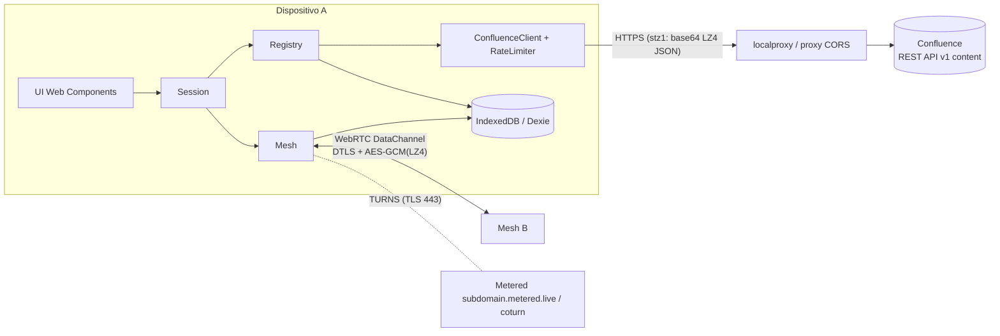
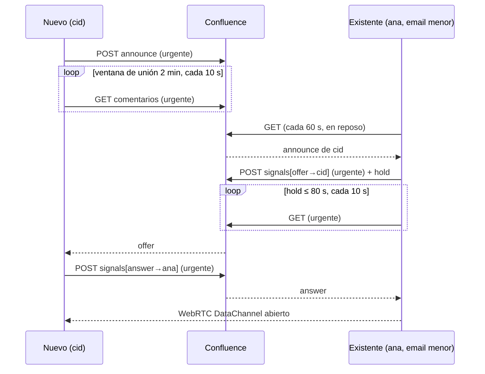

# Statim — Technical Brief

Documento de referencia para desarrollar en Statim: requisitos, arquitectura, protocolo, decisiones de diseño, entorno local, pruebas y limitaciones conocidas.

Los textos de la interfaz están en español. El código, los identificadores y los comentarios del código están en inglés.

---

## 1. Requisitos y decisiones

| Requisito / decisión | Concreción |
|---|---|
| SPA/PWA de mensajería, **mobile-first** | Vanilla TypeScript + Web Components + Vite. PWA con `manifest` y Service Worker propio. |
| **Sin servidor intermedio** que reparta mensajes | Malla WebRTC (DataChannel) entre todos los clientes. |
| Registro y descubrimiento vía **Confluence Cloud REST** | Comentarios de pie de página (API v2) de una página fija. Cada comentario es un sobre JSON. |
| Datos publicados: email, IP pública, semilla de cifrado | Anuncio `announce`. La IP se obtiene por STUN y es solo informativa: WebRTC usa sus propios candidatos ICE. |
| Avatar gráfico | Identicon 5×5 determinista a partir del SHA-256 del email. No viaja por la red; cada cliente lo genera. |
| Persistencia en IndexedDB | Dexie.js. |
| Rotación periódica de la semilla | Cada hora, con un nuevo anuncio. |
| **Semilla simétrica publicada** (decisión explícita del propietario) | AES-GCM 256 con clave derivada por HKDF de la semilla. Riesgo asumido; ver §11. |
| Una sola sala de grupo, **sin historial remoto** | Nada se guarda en servidores. Lo recibido persiste en local. |
| Minimizar pérdidas por desconexión/cierre (móvil) | Cada frame del DataChannel incluye los **mensajes propios de las últimas 10 h** (≤ 128 KB comprimido) además del actual. También se envían al abrir cada canal. Ver §6.2 y §7.5. |
| Segundo plano | *Best-effort*: notificaciones locales mientras la página siga viva. Suspendida = desconectada. |
| Equipo de 10–20 personas | Malla completa, máximo 20 pares (`maxPeers`). |
| **Límite de peticiones a Confluence** | Por defecto 1 petición cada 60 s. Mínimo absoluto 10 s, solo si está justificado. Máximo **100 peticiones "rápidas" al día**. |
| **Compresión LZ4 siempre** | En los comentarios de Confluence y en los mensajes del DataChannel. Formatos binarios / base64, no legibles. |
| CORS en desarrollo/local | Proxy de Vite (`/wiki`), [localproxy](localproxy/localproxy.ps1) en PowerShell o [fake-atlassian](fake-atlassian/fake-atlassian.ps1). |
| Pruebas con informe revisable | Vitest (unitarias + cobertura) y Playwright (e2e con 3 clientes) → `reports/`. |

---

## 2. Arquitectura



**Confluence** es solo el *rendezvous*. Por él pasan anuncios (quién está y con qué semilla) y señalización WebRTC (oferta/respuesta SDP). **Los mensajes del chat nunca pasan por Confluence.** Hay una prueba e2e que lo verifica.

### Por qué WebRTC
Un navegador no puede abrir sockets TCP/UDP hacia una IP arbitraria. WebRTC es la única vía P2P entre navegadores, pero necesita intercambiar SDP: ese intercambio es lo único que se hace por Confluence.

---

## 3. Stack y dependencias

| Paquete | Uso |
|---|---|
| `vite` 8, `typescript` 7 | Build y servidor de desarrollo. TS en modo `strict`. |
| `dexie` 4 | IndexedDB. |
| `lz4js` 0.2 | Compresión LZ4 (formato frame). Sin tipos propios: ver [src/types/lz4js.d.ts](src/types/lz4js.d.ts). |
| `vitest` 5, `@vitest/ui`, `@vitest/coverage-v8`, `happy-dom`, `fake-indexeddb` | Pruebas unitarias. |
| `@playwright/test` | Pruebas end-to-end. |
| PowerShell 7 (`pwsh`) | `localproxy` y `fake-atlassian`. Compatible con 7.0: no usar `HttpClient.Send()` síncrono. |

Gestor de paquetes: **pnpm**. Existe un `package-lock.json` residual de una primera instalación con npm; se puede borrar.

---

## 4. Estructura del repositorio

```
index.html                 Shell HTML (<statim-app>)
public/
  manifest.webmanifest     PWA
  sw.js                    Service Worker (cache del shell; nunca /wiki)
  icons/icon.svg
src/
  main.ts                  Entrada; registra el SW solo en producción
  config.ts                Parámetros del protocolo y variables de entorno
  styles.css               Variables CSS, tema claro/oscuro
  core/
    db.ts                  Esquema Dexie y settings
    crypto.ts              Base64, semillas, HKDF + AES-GCM, SHA-256
    compression.ts         LZ4 con límite anti-bomba
    wire.ts                Frame binario del DataChannel, validación UUID
    protocol.ts            Sobres de Confluence y su validación
    rate-limiter.ts        Cola única + espaciado + presupuesto diario
    confluence-client.ts   REST API v1 content / comments (vía RateLimiter)
    pwa-update.ts          Ciclo de vida y detección de actualizaciones de la PWA
    public-ip.ts           IP pública vía candidato STUN srflx
    registry.ts            Anuncios, rotación, sondeo, señalización agrupada
    mesh.ts                RTCPeerConnection/DataChannel, envío y recepción
    history.ts             Payload {hist, current} con los mensajes propios de 10 h
    session.ts             Orquesta Registry + Mesh; credenciales
    diagnostics.ts         Trazas y logs con buffer circular, sanitización y exportación
    identicon.ts           Avatar SVG
    *.test.ts              Pruebas unitarias
  ui/
    app-shell.ts           <statim-app>: cabecera, estado, login/sala, notificaciones
    login-view.ts          <login-view>
    chat-room.ts           <chat-room>
    peer-list.ts           <peer-list>
    peer-avatar.ts         <peer-avatar>
    components.test.ts
  test/setup.ts            fake-indexeddb, limpieza entre tests
  types/lz4js.d.ts
localproxy/localproxy.ps1  Proxy CORS hacia Confluence (o hacia fake-atlassian)
fake-atlassian/fake-atlassian.ps1  Mock en memoria de la API de comentarios
test-e2e/                  Playwright: config, helpers, chat.spec.ts
vitest.config.ts
reports/                   Informes generados (ignorado por git)
```

---

## 5. Módulos del núcleo

### `config.ts`
Valores por defecto (producción). Los tiempos marcados con *t()* se multiplican por `VITE_TIME_SCALE`.

| Clave | Valor | Significado |
|---|---|---|
| `seedRotationMs` | 1 h | Rotación de la semilla propia. |
| `seedGraceMs` | 10 min | Las semillas propias anteriores se borran pasado este margen. |
| `announceTtlMs` | 70 min | Un par se considera activo si se anunció en este intervalo. También es la ventana de lectura inicial. |
| `fastPollMs` *t()* | 10 s | **Hueco mínimo absoluto** entre peticiones (solo urgentes). |
| `idlePollMs` *t()* | 60 s | Hueco normal entre peticiones. |
| `dailyFastRequestBudget` | 100 | Peticiones rápidas permitidas al día (hueco < 60 s). |
| `startupFastPollMs` *t()* | 2 min | Ventana de unión con sondeo rápido. Debe superar `idlePollMs`. |
| `fastHoldMs` *t()* | 80 s | Duración máxima del sondeo rápido tras enviar una oferta. |
| `answerTimeoutMs` *t()* | 150 s | Espera máxima de la respuesta SDP. |
| `signalBatchDelayMs` *t()* | 1,5 s | Ventana para agrupar señales en un solo comentario. |
| `signalTtlMs` | 5 min | Antigüedad a partir de la cual se borran las señales propias. |
| `maxPollBackoffMs` *t()* | 5 min | *Backoff* máximo ante errores. |
| `maxPeers` | 20 | Tamaño máximo de la malla. |
| `historyWindowMs` | 10 h | Ventana de mensajes propios que viajan en cada frame. |
| `historyMaxBytes` | 128 KB | Máximo del payload comprimido; se descartan primero los más antiguos. |

### `RateLimiter` ([rate-limiter.ts](src/core/rate-limiter.ts))
**Todas** las peticiones a Confluence (GET, POST y DELETE) pasan por una cola única por cliente.

- Cada trabajo tiene una urgencia `boolean | () => boolean`, que se evalúa en cada `pump()`. Así, un sondeo encolado como normal puede pasar a urgente.
- Hueco requerido: 10 s si el trabajo es urgente **y** queda presupuesto; si no, 60 s.
- Una petición que sale menos de 60 s después de la anterior consume 1 unidad del presupuesto diario.
- El presupuesto se guarda en `localStorage["statim.fastBudget.<email>"] = {day, used}`. El día es la fecha UTC (`toISOString().slice(0,10)`).
- Los urgentes se adelantan a los normales; entre trabajos de la misma urgencia el orden es FIFO.
- `penalize(ms)` bloquea la cola (se usa con `Retry-After`). `close()` rechaza lo pendiente.

### `ConfluenceClient` ([confluence-client.ts](src/core/confluence-client.ts))
- Autenticación `Bearer <token>` (o PAT) y `credentials: 'omit'`.
- `post(envelope, urgent)` → `POST /rest/api/content` con `{ type: 'comment', container: { id: pageId, type: 'page' }, body: { storage: { value, representation: 'storage' } } }`.
- `listSince(sinceMs, urgent)` → `GET /rest/api/content/{id}/child/comment?expand=body.storage,version&limit=100`. Recorre `_links.next` y se detiene en el primer comentario anterior a `since`.
- `remove(id)` → `DELETE /rest/api/content/{id}`.
- Los errores se lanzan como `ConfluenceError { status, retryAfterMs }`.

### `Registry` ([registry.ts](src/core/registry.ts))
- `start()`:
  1. Obtiene la IP pública vía STUN (≤ 5 s).
  2. Rota la semilla si toca y **anuncia de forma urgente** (unirse justifica la urgencia).
  3. Arranca el bucle de sondeo y un temporizador de 60 s que comprueba la rotación y la purga.
- El **bucle de sondeo** es continuo; el ritmo lo marca el `RateLimiter`. Es urgente si se cumple alguna de estas condiciones:
  - estamos dentro de la ventana de unión;
  - hay *holds* activos (`holdFastPolling()`).
- **Procesado** de lo leído:
  - Ventana de solapamiento de 30 s para tolerar comentarios que se hacen visibles tarde.
  - `announce` ajeno → *upsert* del `Peer` (guarda las últimas 3 semillas) y evento `peer`.
  - `signals` → entrega solo los items con `to == email` **y** `toSession == session`. Desduplica por `commentId` (`processedSignals`).
- `sendSignal(item)` encola. Tras 1,5 s se publica **un único comentario** con hasta 20 items, de forma urgente.
- **Purga** (no urgente): borra los anuncios propios salvo el último y las señales propias con más de 5 min. Ignora los 404.
- Eventos: `peer`, `signal`, `seed`, `error`.

### `Mesh` ([mesh.ts](src/core/mesh.ts))
- **Iniciador = email menor** (orden lexicográfico). El otro extremo espera la oferta.
- **ICE no-trickle:** se espera a terminar de recoger candidatos (≤ 4 s) y se envía el SDP completo. Así cada conexión cuesta 1 oferta + 1 respuesta, sin comentarios `ice`.
- Al publicar una oferta se activa `holdFastPolling()`. Se libera al recibir la respuesta, al cerrar o tras 80 s.
- **Fallos:**
  - Sin respuesta en 150 s → se cierra y **no se reintenta** (el par probablemente se fue).
  - Estado `disconnected` durante 15 s, o `failed` → se cierra. Si hubo respuesta, el iniciador reintenta **una vez** a los 10 s.
- Un anuncio con sesión distinta para un par existente cierra el enlace anterior y, si somos iniciadores, se vuelve a conectar.
- **Envío:**
  1. Guarda el mensaje propio con `ts = max(now, último ts propio + 1)` y `msgId = "<email>|<ts>"`.
  2. Construye el payload `{hist, current}` con los mensajes propios de las últimas 10 h ([history.ts](src/core/history.ts)).
  3. Lo comprime, lo recorta a 128 KB y lo cifra **una vez** con la semilla propia actual.
  4. Difunde el mismo frame a todos los canales abiertos.
- **Al abrir un canal** se envía un frame solo con `hist` (si hay mensajes propios en la ventana).
- **Recepción** (serializada por emisor):
  1. Decodifica el frame (≤ 129 KB).
  2. Busca la semilla del emisor por `seedId`. Si aún no se conoce, encola el frame (≤ 50 por par) y lo reintenta en el siguiente evento `peer`.
  3. Descifra, descomprime (≤ 1,25 MB) y valida (≤ 5000 entradas, ≤ 4000 caracteres cada una).
  4. Cada entrada se identifica por `"<emisor>|<ts>"`. Solo se guardan las nuevas y se emite **un único** evento `messages` por frame (`MessageBatch { from, messages (ascendente por ts), current? }`).
  5. La marca de tiempo es la **hora de envío del autor** (su reloj). `<chat-room>` inserta los mensajes en ese orden.
- Las entradas se atribuyen siempre al emisor del canal: un par solo puede publicar mensajes propios.
- Eventos: `messages`, `links`, `error`.

### `Session` ([session.ts](src/core/session.ts))
Crea `ConfluenceClient → Registry → Mesh` y los arranca y para juntos. Gestiona las credenciales en `settings` (`baseUrl`, `pageId`, `email`, `token`). `clearToken()` es lo que hace "Salir".

---

## 6. Protocolo

### 6.1 Comentarios en Confluence

Cuerpo en formato *storage*:

```
<p>stz1:BASE64( LZ4_FRAME( UTF8( JSON(envelope) ) ) )</p>
```

- Base64 no contiene caracteres especiales de HTML, así que no hace falta escapar.
- Al leer: `DOMParser` → `textContent` → prefijo `stz1:` → base64 → LZ4 (≤ 1 MB) → `JSON.parse` → `parseEnvelope()`.
- `parseEnvelope` **reconstruye** el objeto solo con los campos validados. Cualquiera con acceso a la página puede escribir comentarios, así que no se confía en ellos.

**Anuncio**
```json
{
  "t": "announce", "v": 1,
  "email": "ana@empresa.com",
  "session": "8d1c…-uuid-por-arranque",
  "ip": "203.0.113.7",
  "seedId": "UUID",
  "seed": "base64(32 bytes)",
  "ts": 1793800000000
}
```

**Lote de señales**
```json
{
  "t": "signals", "v": 1,
  "from": "ana@empresa.com", "fromSession": "UUID",
  "items": [
    { "to": "bob@empresa.com", "toSession": "UUID", "kind": "offer",  "data": "v=0\r\n…SDP…" },
    { "to": "cid@empresa.com", "toSession": "UUID", "kind": "answer", "data": "v=0\r\n…SDP…" }
  ],
  "ts": 1793800000000
}
```

**Reglas de validación:**

| Campo | Regla |
|---|---|
| `v` | Debe ser `1`. |
| Emails | Se normalizan a minúsculas. |
| `session`, `fromSession`, `toSession` | Hasta 64 caracteres. |
| `seedId` | Debe ser un UUID. |
| `ip` | Hasta 64 caracteres. |
| `kind` | `offer` o `answer`. |
| `items` | Como máximo 20. |
| SDP | Hasta 20 000 caracteres (se comprueba en `Mesh`). |

### 6.2 Frame del DataChannel (binario)

```
offset  size  campo
0       1     version (=2)
1       16    packetId (UUID en bytes, aleatorio por envío)
17      16    seedId   (UUID en bytes)
33      12    IV AES-GCM
45      n     AES-GCM( LZ4_FRAME( UTF8( JSON payload ) ) )   (incluye tag de 16 bytes)
```

Payload ([history.ts](src/core/history.ts)):

```json
{ "hist": ["1793800000000 Hola a todos", "1793800021000 Quiero comentar la tarea A"],
  "current": "1793800110000 tengo que añadir X" }
```

- Cada entrada es `"<ts en ms> <texto>"`. `hist` son los mensajes propios del emisor de las últimas 10 h, en orden ascendente, sin incluir `current`. `current` falta en los frames que se envían al abrir un canal.
- Si el payload comprimido supera 128 KB, se descarta el 10 % más antiguo de `hist` hasta que quepa. `current` nunca se descarta.
- La versión 1 (un solo texto por frame) ya no se acepta.
- `binaryType = 'arraybuffer'`.
- Primero se comprime y después se cifra: lo cifrado no es comprimible.
- LZ4 añade unos 15 bytes de cabecera de frame. En textos muy cortos el resultado es mayor que el original; es una decisión aceptada por el propietario.
- El SCTP de WebRTC admite mensajes de 256 KB en Chromium, así que 128 KB por frame queda dentro del margen.

### 6.3 Cifrado
- Semilla: 32 bytes aleatorios (`crypto.getRandomValues`) y un `seedId` UUID.
- Clave: `HKDF-SHA256(seed, salt = vacío, info = "statim-msg-v1")` → AES-GCM 256, cacheada por semilla.
- IV aleatorio de 12 bytes por mensaje.
- El transporte WebRTC añade además DTLS obligatorio.

### 6.4 Compresión ([compression.ts](src/core/compression.ts))
`decompress(data, maxBytes)` descomprime sobre un buffer fijo de `maxBytes`. Si el tamaño resultante lo supera, rechaza el frame (protección frente a bombas de descompresión).

> No se usa `lz4js.decompressBound`: para frames sin *content size* devuelve el máximo del bloque (8 MB).

---

## 7. Flujos

### 7.1 Unión a la sala



| Situación | Tiempo típico hasta conectar | Peticiones rápidas |
|---|---|---|
| Quien entra | ≤ ~60–80 s | ~15 |
| Cada miembro existente, por cada alta | Igual que quien entra | 1 (si responde) a ~9 (si inicia) |
| Reposo | No aplica | 0 (1 petición/min) |
| Presupuesto agotado | ~2–3 min | 0 |

### 7.2 Rotación de semilla
Cada 60 s se comprueba la antigüedad. Al cumplir 1 h:
1. Se genera una semilla nueva y se anuncia (no urgente).
2. Se borran las semillas propias de más de 10 min.
3. Los receptores guardan las 3 últimas semillas de cada par, así que los mensajes cifrados con la semilla anterior se siguen descifrando.

### 7.3 Recarga / reconexión
Una recarga crea una sesión nueva y se anuncia de nuevo. Los demás detectan la sesión distinta, cierran el enlace anterior y el iniciador vuelve a conectar. El historial local se mantiene (está cubierto por e2e).

### 7.4 Salida de un par
El canal se cierra y el par pasa a "no conectado". El par sigue en la lista de equipo hasta 70 minutos después de su último anuncio.

### 7.5 Recuperación de mensajes perdidos (historial de 10 h)
Cada cliente reenvía sus propios mensajes de las últimas 10 h en cada envío y al abrir cada canal. Así:
- Quien cierra la app (p. ej. el sistema la suspende en el móvil) y vuelve recibe, al reconectar, lo que escribieron en ese tiempo los compañeros **que siguen conectados**.
- Quien llega tarde recibe la conversación reciente de cada compañero conectado.
- **No se recuperan** los mensajes de un autor que ya no está conectado: cada cliente solo publica lo suyo y no hay reenvío de mensajes ajenos.
- Coste: un frame puede llegar a 128 KB en cada envío. Va por WebRTC, así que **no gasta peticiones a Confluence**.

---

## 8. Persistencia

### IndexedDB (`statim`, versión 1, Dexie)

| Tabla | Índices | Contenido |
|---|---|---|
| `peers` | `email, lastSeen` | `session`, `ip`, `seeds[≤3]`, `avatarSvg`, `lastSeen` |
| `messages` | `++id, &msgId, ts, from` | `msgId = "<email>\|<ts>"`, `text`, `ts` de envío del autor |
| `ownSeeds` | `seedId, createdAt` | Semilla actual (y las anteriores durante el margen de gracia) |
| `processedSignals` | `commentId, ts` | Desduplicación de señales (se purga a los 70 min) |
| `ownComments` | `commentId, kind, ts` | Comentarios propios pendientes de purga |
| `settings` | `key` | `baseUrl`, `pageId`, `email`, `token` |

**Si cambias el esquema**, añade `this.version(2).stores({...})` con su migración. No edites la versión 1.

### localStorage
`statim.fastBudget.<email>`: presupuesto diario de peticiones rápidas.

---

## 9. Interfaz

Web Components con Shadow DOM, sin framework. Los estilos usan las variables CSS de [styles.css](src/styles.css), que atraviesan el Shadow DOM, e incluyen tema claro/oscuro y márgenes de *safe area*.

| Componente | API |
|---|---|
| `<statim-app>` | Orquesta login ↔ sala. Muestra el estado en la cabecera. Un 401/403 → vuelve al login. Si `document.hidden`, muestra **una** notificación por lote: el mensaje actual o "N mensaje(s) recuperado(s)". |
| `<login-view>` | Setters `values`, `error`, `busy`. Evento `login` (`CustomEvent<LoginDetails>`). Secciones para TURN/TLS, proxy y visor/exportador de logs de diagnóstico. Touch targets táctiles optimizados para móvil (≥ 52 px en inputs y botones). |
| `<chat-room>` | `attach(session)` / `detach()`. Muestra los últimos 200 mensajes. Enter envía, Shift+Enter hace salto de línea. Repintado sin saltos (ver abajo). |
| `<peer-list>` | `attach(session)` / `detach()`. Evento `count` con el número de conectados. |
| `<peer-avatar email="…" online>` | Identicon cacheado. |

- **Mobile-first:** la lista de equipo es un panel superpuesto; a partir de 900 px pasa a columna fija. Altura `100dvh`. Botones de 44 px o más.
- **Layout:** la altura se reparte con grids `minmax(0, 1fr)` hasta la `<ol>`, que es la única zona con scroll. No pongas `display` en `statim-app` desde [styles.css](src/styles.css): los estilos del documento ganan a `:host` y romperían el grid, y el cuadro de texto acabaría fuera de pantalla.
- **Repintado sin saltos (`<chat-room>`):**
  - Cada lote se inserta en una sola pasada, en orden de `ts`, con un cursor que recorre la lista desde el final (O(n+m)). Los `msgId` ya pintados se ignoran.
  - Si el lector estaba al final (< 80 px), se queda al final.
  - Si no, se guarda el primer mensaje visible y su desplazamiento, y se restaura tras insertar. Así, el historial que llega por encima no mueve lo que se est\u00e1 leyendo. El anclaje es manual (`overflow-anchor: none`) porque Safari iOS no tiene anclaje nativo.
  - Los mensajes nuevos que quedan por debajo se cuentan en el aviso "N mensajes nuevos \u2193". Se oculta al llegar al final.
  - Los mensajes que llegan aparecen con un *fade-in* de 240 ms (solo opacidad, sin cambios de layout), desactivado con `prefers-reduced-motion`.
- **Seguridad:** todo texto externo se pinta con `textContent`. Nunca uses `innerHTML` con datos de pares o de Confluence; hay un test que lo vigila.

---

## 10. PWA

- [manifest.webmanifest](public/manifest.webmanifest): `standalone`, orientación vertical, icono SVG `any maskable`.
- [sw.js](public/sw.js):
  - Pre-cachea el shell completo (HTML, manifest, iconos y los bundles JS/CSS generados por Vite).
  - Navegación con estrategia *network-first* (respaldo `index.html`); recursos con *stale-while-revalidate*.
  - **Nunca** cachea `/wiki` ni peticiones de otro origen.
  - Gestiona `notificationclick`.
  - Escucha el mensaje `SKIP_WAITING` para activarse sin interrumpir sesiones activas sin consentimiento.
- **Mecanismo de actualización ([pwa-update.ts](src/core/pwa-update.ts)):**
  - Registro con `updateViaCache: 'none'` para forzar comprobación de cambios en la red.
  - Comprobaciones proactivas: al registrarse, en `visibilitychange` (al volver a primer plano), en `focus`, en reconexión `online` y sondeo periódico.
  - Notificación en la interfaz (`<statim-app>`): banner superior no invasivo con botón «Actualizar» y opción de descartar (dejando un botón sutil en la cabecera).
  - Al pulsar «Actualizar»: envía `SKIP_WAITING` al Service Worker en espera y recarga en `controllerchange`.
  - Build automático (`vite.config.ts`): inyecta automáticamente la versión de caché y los nombres hasheados de los assets en `dist/sw.js` en cada compilación.

---

## 11. Seguridad: modelo y riesgos conocidos

| Riesgo | Estado |
|---|---|
| **Semilla simétrica publicada en Confluence.** Quien tenga acceso a la página y pueda capturar el tráfico podría descifrar la capa de aplicación. | Aceptado por el propietario. DTLS de WebRTC sigue protegiendo el tránsito. Alternativa preparada para el futuro: ECDH P-256 + claves públicas (sustituir `crypto.ts` y el anuncio). |
| **Suplantación:** cualquiera con acceso a la página puede publicar un `announce` con otro email. | Pendiente. Mitigación posible: comprobar `version.authorId` del comentario frente al `accountId` del email. |
| Token API sin cifrar en IndexedDB | Aceptado en v1. "Salir" lo borra. |
| Credenciales TURN / Metered | No se almacenan en la app, ni en disco ni en IndexedDB. Se informan opcionalmente en una sección dedicada de la pantalla de acceso y solo se usan en memoria para resolver los servidores TURNS (TLS 443) durante la sesión activa. |
| Contenido malicioso en comentarios o frames | Validación estricta por campo, límites de tamaño, LZ4 con límite, AES-GCM autenticado, `textContent` en la UI. |
| Proxy abierto | `localproxy` solo escucha en `localhost`, solo reenvía `/wiki/` al destino fijo, exige `https` (o `http` a localhost), aplica CORS por lista de orígenes y **no imprime el token**. |

---

## 12. Configuración y variables de entorno

Copiar [.env.example](.env.example) a `.env`.

| Variable | Uso |
|---|---|
| `CONFLUENCE_BASE_URL` | Solo `vite dev`: destino del proxy `/wiki`. Quita `Origin`/`Referer` para evitar el XSRF 403 de Atlassian. |
| `VITE_CONFLUENCE_BASE_URL` | Valor por defecto del campo URL del login. Vacío = mismo origen. |
| `VITE_CONFLUENCE_PAGE_ID` | Valor por defecto del ID de página. |
| `VITE_METERED_DOMAIN`, `VITE_METERED_API_KEY` | Subdominio y clave de Metered opcionales (solo tests/dev). En producción se introducen en la pantalla de acceso y nunca se guardan. |
| `VITE_TURN_URL`, `VITE_TURN_USERNAME`, `VITE_TURN_CREDENTIAL` | Servidor TURN opcional (coturn). |
| `VITE_STUN_URLS` | Lista separada por comas. Vacío = sin STUN (lo usan los e2e). Por defecto, los STUN de Google. |
| `VITE_TIME_SCALE` | **Solo pruebas.** Multiplica los tiempos del protocolo (0.1 → 10 s pasan a 1 s). |

---

## 13. Desarrollo local

### Comandos

```bash
pnpm install
pnpm dev            # Vite en :5173
pnpm build          # tsc (incluye tests) + vite build
pnpm preview        # build servido en :4173
pnpm test           # Vitest + cobertura
pnpm test:watch
pnpm test:e2e       # Playwright (arranca sus propios servidores)
pnpm test:all
pnpm report:unit    # abre el informe HTML de Vitest
pnpm report:e2e     # abre el informe HTML de Playwright
```

Primera vez con Playwright: `pnpm exec playwright install chromium`.

### Tres formas de hablar con "Confluence"

| Modo | Cómo | Cuándo |
|---|---|---|
| Proxy de Vite | `.env` con `CONFLUENCE_BASE_URL`, campo URL vacío | Desarrollo contra Confluence real |
| [localproxy](localproxy/localproxy.ps1) | `pwsh localproxy/localproxy.ps1 https://sitio.atlassian.net [-Port 8787] [-AllowedOrigin …] [-PreviewLength 500]` → URL `http://localhost:8787` | Ver en consola cabeceras, parámetros y respuestas; sirve también con la app compilada |
| [fake-atlassian](fake-atlassian/fake-atlassian.ps1) | `pwsh fake-atlassian/fake-atlassian.ps1 [-Port 8790]`, directo o detrás de localproxy | Varios clientes en local sin Atlassian |

**fake-atlassian:**
- Endpoints: `POST /rest/api/content`, `GET /rest/api/content/{id}/child/comment` (con `expand`, `limit` ≤ 250, `start` y `_links.next`) y `DELETE /rest/api/content/{id}` (solo el autor; si no, 403). Mantiene compatibilidad con `/wiki/api/v2/`.
- Administración: `GET|DELETE /__admin/comments`.
- Acepta cualquier Bearer token o Basic auth.

**Varios clientes en una máquina:** usa perfiles de navegador distintos (normal, incógnito u otro navegador). Comparten origen, pero no IndexedDB ni `localStorage`. Si agotas el presupuesto diario probando, borra `statim.fastBudget.<email>`.

---

## 14. Pruebas

### Unitarias (Vitest + happy-dom + fake-indexeddb)
- Ficheros `src/**/*.test.ts`; el setup está en [src/test/setup.ts](src/test/setup.ts) y limpia las tablas y `localStorage` antes de cada test.
- Qué cubren: compresión, criptografía, frame, protocolo, identicon, rate limiter (con temporizadores falsos y los valores reales de 10 s / 60 s / 100), cliente Confluence (`fetch` simulado), registry (cliente falso y `public-ip` simulado), credenciales de sesión y componentes de UI (incluido un test anti-XSS).
- `Mesh` no tiene pruebas unitarias: depende de WebRTC real y se cubre en e2e.
- Usa `setTimeout` global (no `window.setTimeout`) en el código del núcleo, o las pruebas con temporizadores falsos no funcionarán.

### End-to-end (Playwright, [test-e2e/](test-e2e))

[playwright.config.ts](test-e2e/playwright.config.ts) levanta la cadena completa:

```
Chromium (Pixel 7) → Vite :5180 → localproxy :8787 → fake-atlassian :8790
```

- La app se arranca con `VITE_TIME_SCALE=0.1` y sin STUN.
- Chromium se lanza con `--disable-features=WebRtcHideLocalIpsWithMdns`: sin esa opción, los candidatos `host` son nombres mDNS que no se resuelven entre contextos.

Escenarios de [chat.spec.ts](test-e2e/chat.spec.ts), en serie con 3 contextos independientes (Ana, Bob y Cid):
1. Unión y malla completa ("2 conectados" en los tres).
2. Cada mensaje llega a los otros dos, con su autor y en orden.
3. Confluence solo contiene `stz1:` + base64 y ningún texto del chat.
4. Recarga: el historial persiste y el cliente se reconecta.
5. Un cliente se va y los demás lo detectan.
6. Bob cierra la app, Ana escribe y, al volver, Bob recibe lo que se perdió (historial de 10 h).
7. Dan llega tarde: recibe los mensajes de Ana y Bob en orden, y no los de Cid, que ya no está.
8. Bob lee mensajes antiguos y llega uno nuevo: no se mueve, aparece "1 mensaje nuevo ↓" y al pulsarlo baja al final. También comprueba que el cuadro de texto sigue en pantalla con la conversación llena.
9. La pantalla de login es mobile-first (sin scroll horizontal, botones ≥ 44 px).
10. Inicio de sesión con API Key de Metered usando TURNS sobre TLS (puerto 443), verificando que la clave nunca se almacena en localStorage, sessionStorage ni IndexedDB, y que el formulario se limpia al salir.

### Informes (`reports/`, ignorado por git)

| Informe | Ruta |
|---|---|
| Unitarias HTML | `reports/unit/` (abrir con `pnpm report:unit`) |
| Unitarias JUnit | `reports/unit/junit.xml` |
| Cobertura | `reports/coverage/index.html` y `cobertura-coverage.xml` |
| E2E HTML (pasos, capturas por cliente, trazas y vídeo si falla) | `reports/e2e/` (`pnpm report:e2e`) |
| E2E JUnit | `reports/e2e-junit.xml` |
| Artefactos e2e | `reports/e2e-artifacts/` |

---

## 15. Convenciones

- TypeScript `strict`, módulos ES e imports con extensión `.ts`.
- Estado privado con campos `#private`. Comunicación entre capas mediante `EventTarget` y `CustomEvent<T>`.
- Comentarios en el código: solo lo que el código no expresa, en una línea corta.
- Toda entrada externa (Confluence, DataChannel, formularios) se valida en el límite del sistema y nunca se inserta como HTML.
- Cualquier petición nueva a Confluence **debe** pasar por `ConfluenceClient` (y por tanto por `RateLimiter`) e indicar su urgencia de forma justificada.
- Si cambias un formato de transporte, versiona: prefijo `stz1:` → `stz2:`, `v` en los sobres o el byte de versión del frame.

---

## 16. Limitaciones y trabajo pendiente

- **No validado aún contra Confluence Cloud/Server real:** el formato exacto de `_links.next` (se contemplan `/rest/api/…` y `/api/…`).
- Producción sin proxy: Atlassian Cloud no permite CORS desde orígenes arbitrarios. Hace falta un reenviador o servir la app desde un origen permitido.
- Iconos PNG (180/512) para instalación óptima en iOS.
- Verificación del autor de los anuncios (§11).
- Migración a ECDH si se quiere confidencialidad real frente a quien lee la página.
- Malla completa: por encima de ~20 pares convendría una topología parcial o un SFU.
- Segundo plano real en móvil: solo con Web Push (requiere un servicio push) o con un contenedor nativo (Capacitor).
- El campo `ip` del anuncio es informativo y no se usa para conectar.
